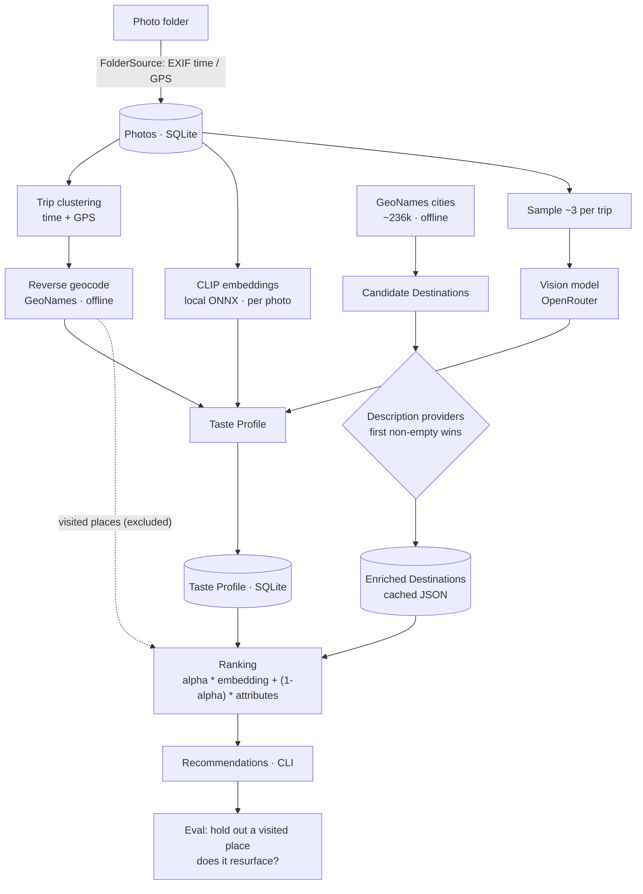
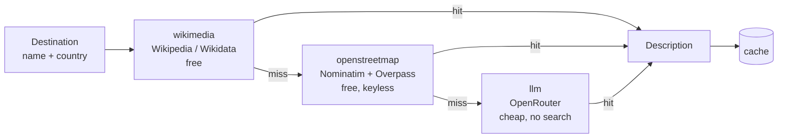

# Wanderlens

Learn a travel **Taste Profile** from a personal **Photo Archive** and recommend
new **Destinations**. Single-user today, built to become a portable open-source
app later.

## What it does

1. **Ingest** photos from a local folder (EXIF timestamp, GPS, dimensions).
2. **Profile** them: group photos into trips (time + GPS), resolve each trip to a
   country/city offline, embed every photo locally with CLIP, and tag a sample
   with a hosted vision model.
3. **Recommend** new destinations: embed candidate Destinations, rank them
   against your taste (excluding where you've already been), and explain each
   using your own photos.
4. **Evaluate** by holding out a visited place and checking whether it resurfaces.

## How it works



**Description providers** — each candidate Destination is described by the first
provider that returns something, then cached:



## Install

```bash
python3 -m venv .venv
.venv/bin/pip install -e '.[dev,embeddings,web]'
```

The CLIP ONNX model is downloaded automatically on first use into
`data/models/`. Offline place data goes in `data/catalog/`:

```bash
mkdir -p data/catalog
curl -sL https://download.geonames.org/export/dump/cities500.zip -o /tmp/c.zip
python3 -c "import zipfile; zipfile.ZipFile('/tmp/c.zip').extractall('data/catalog')"
curl -sL https://download.geonames.org/export/dump/countryInfo.txt -o data/catalog/countryInfo.txt
```

To pull photos from a pCloud public folder link (walks subfolders, skips
already-downloaded files):

```bash
.venv/bin/python scripts/download_pcloud.py --code <public-link-code>
```

## Use

```bash
# read photos and build the taste profile (add --tag to also run the VLM)
.venv/bin/python -m wanderlens ingest [--tag]

.venv/bin/python -m wanderlens profile show
.venv/bin/python -m wanderlens recommend --count 5
.venv/bin/python -m wanderlens eval [--holdout Malta] [--synthetic]
.venv/bin/python -m wanderlens guide [--count 5] [--refresh] [--no-llm]
.venv/bin/python -m wanderlens synthetic --dir /tmp/wl-syn   # runnable mock archive
.venv/bin/python -m wanderlens feedback --destination wv:Kotor --action like
```

The "why this is for you" is evidence-based: each Recommendation names the
closest of your trips, the attributes it shares with your taste (weighted by how
often they recur), and how new it is (distance from your nearest visit). Add
`--explain-llm` (needs an API key) to have a pinned LLM rewrite those facts into
prose; the text is cached per evidence, so reruns are reproducible and the
deterministic explanation is always the fallback.

Results are **diversified** (Maximal Marginal Relevance) so the list is not eight
variations of one vibe, and each carries a **famous / balanced / uncommon** label
from Wikipedia pageviews. Tune with `recommend --diversity 0.25` and
`recommend --novelty {familiar|balanced|uncommon}`.

Ranking blends embedding similarity with canonical-attribute matching at `alpha`
(default `0.25`, override with `WANDERLENS_ALPHA` or `recommend --alpha`).
Attribute matching is word-boundary based and weighted by **specificity (IDF)**,
and a trip contributes a full-weight taste facet only once it has a few photos.
A hosted cheap model runs **as part of the chain** (not just as a fallback) to
turn a trip's tags into structured attributes and to enrich thin destination text
before embedding; results are cached by input + model + prompt, and a missing key
or any model error falls back to the local, deterministic representation
(`WANDERLENS_ENRICH_TASTE=0` disables it). Trip splitting is configurable via
`WANDERLENS_SPLIT_GAP_HOURS` / `WANDERLENS_SPLIT_JUMP_KM`, and
`WANDERLENS_FACET_MIN_PHOTOS` sets the photos needed for a full-weight facet.

`eval --synthetic` ranks a reproducible synthetic gallery and reports
**precision@k / MRR**, so ranking changes can be measured without a large archive.

`wanderlens synthetic --dir <dir>` writes a deterministic **runnable mock
archive** — six taste clusters, ~300 candidate destinations, tens of trips — and
profiles it with a deterministic vision + embedder, so attribute taste is
exercised without a key; point
`WANDERLENS_DATA_DIR=<dir> WANDERLENS_EMBEDDER=synthetic` at it and run
`recommend` to test ranking on a broad dataset instead of a few photos.

**Feedback** biases ranking: `wanderlens feedback --destination <id> --action
{like|save|dislike|skip}` (or the buttons on a destination page) records a
reaction, and likes/saves are favoured while dislikes/skips are pushed down;
`--list` shows and `--clear` removes it. Catalog names are normalized and
deduplicated on load. `recommend --refresh-media` re-fetches media so the new
quality tiering applies to already-cached destinations, and near-duplicate images
are dropped by perceptual hash.

Each recommended destination also gets a **sourced case** — a short narrative
plus citation links — built from Wikivoyage/Wikipedia/Wikidata. With an
`OPENROUTER_API_KEY`, DuckDuckGo web search and the model write a more
captivating, grounded version (cached by input + model + prompt; the keyless case
is always the fallback). Guides include a **deterministic day-by-day itinerary**
from the destination's points of interest (no key needed; the LLM itinerary is
used when a key is present), **travel diaries/journals**, and a scannable
description. Images prefer Wikimedia Commons **Quality / Featured / Valued**
files, and external photo searches (Commons, Getty, Google Images) are linked
out — proprietary images are never embedded. Opt into extra sources (Openverse)
with `WANDERLENS_MEDIA_SOURCES=openverse`, and add diary links with
`WANDERLENS_TRAVEL_BLOGS=url1,url2`.

### Web dashboard

A local, read-only dashboard over the same data (FastAPI + Jinja + HTMX + a
little Alpine.js, no build step):

```bash
.venv/bin/python -m wanderlens serve            # http://127.0.0.1:8000
.venv/bin/python -m wanderlens serve --port 8765
```

It shows the Taste Profile, the ranked Recommendations (with their score
components), each trip's own photos, and a map of visited and recommended
places. It renders from the database only and never triggers ingestion or
ranking — run `ingest` / `recommend` (or `ingest --tag`) first. Bound to
localhost and single-user; front-end assets are vendored so it works offline.

Recommendations now carry **pictures and a real destination page**. When you run
`recommend`, each recommended Destination also fetches a Wikipedia image, an
expanded description, and a region shape from free, keyless sources, cached under
`data/media/` and in the database. Galleries are sourced from **curated place
imagery** — the item's Wikidata image, the article's own media, and the place's
Commons category — filtered for quality, with a proximity search only as a
fallback. From a card, `/destinations/{id}` opens a page
with a hero image, the full description (with source and attribution), a **world
locator and a regional map** highlighting the area — a precise boundary when one
exists, an "approximate" circle otherwise — and your own most-similar trip photos
("You loved places like this"). Use `recommend --no-media` to skip the network.

Maps use **keyless** OpenStreetMap tiles by default (darkened in dark mode). To
point them at another provider (including a keyed one), set `WANDERLENS_TILE_URL`
and `WANDERLENS_TILE_ATTRIBUTION`.

### Travel guides

`wanderlens guide` builds a richer page for each recommended destination, cached
and rendered offline: a travel-oriented description (Wikivoyage), a photo gallery
(≥10 where available), points of interest plotted on the map, a per-month climate
summary (Open-Meteo), books to read (Wikidata + Open Library), films/series set
there, resource links, similar destinations, and suggested itineraries. Curated
itineraries come from Wikivoyage; with an API key, `guide` also synthesises a
day-by-day itinerary with the LLM (pinned prompt, cached, marked "AI-generated",
with sources) — use `--no-llm` to skip it, `--refresh` to rebuild.

`--tag` sends a small sample of photos (~3 per trip) to the configured vision
model. Without it, subject tags are skipped; geography and aesthetics are still
computed locally.

Visited areas are excluded from recommendations by **proximity** (default 60 km
around each trip), not by country — so one Trentino trip does not remove all of
Italy. Tune with `WANDERLENS_EXCLUDE_RADIUS_KM`.

## Architecture

Ports and adapters. The `core/` never imports a photo manager or a model runtime:

```
wanderlens/
  core/       taste + recommendation, ports, vocabulary (no external imports)
  sources/    Photo Source adapters (local folder; Immich deferred)
  catalog/    place data (GeoNames/Wikidata), normalization, offline cache
  models/     the only place that imports onnxruntime/tokenizers or calls a VLM
  pipeline/   ingest, profile, recommend, evaluate
  cli/        argparse entry point
```

Data (`data/`) is git-ignored: photos, the SQLite database, model files, catalog.

## Destination descriptions (providers)

Candidate destinations are described by an ordered chain of providers; the first
non-empty description wins and is cached. Wikimedia is one provider, not the only
one. Configure the order via env/config:

- `wikimedia` (default) — Wikipedia extracts / Wikidata descriptions, free.
- `openstreetmap` (default) — free, keyless feature words from OSM tags
  (coastline, beach, marina, historic…), via Nominatim + Overpass. Best-effort:
  the public Overpass servers are sometimes busy and the chain moves on.
- `llm` (default fallback) — one sentence from a cheap hosted LLM
  (`meta-llama/llama-3.1-8b-instruct`, no search by default).

Default order: `wikimedia → openstreetmap → llm`.

```bash
WANDERLENS_DESCRIPTION_PROVIDERS=wikimedia,openstreetmap,llm
WANDERLENS_LLM_MODEL=meta-llama/llama-3.1-8b-instruct
```

Only place names are sent to the LLM — never photos. Results are cached in
`data/catalog/destinations*.json`, so each place is described at most once.

**Do not add `:online` by default.** Search grounding is billed per request
(≈ $0.007 via Exa) and costs far more than the tokens. Wikimedia already covers
notable places; if you need search for obscure ones, opt in and prefer a cheap
engine, e.g. `WANDERLENS_LLM_MODEL=meta-llama/llama-3.1-8b-instruct:online` with
Parallel turbo (`$0.001`/request).

## Destination catalog

Recommendation candidates come from a **travel** catalog at **area granularity** —
Wikivoyage (Regions / Cities / Other destinations) — so suggestions are places
like *Costa del Sol* or *Cinque Terre*, not individual municipalities. Each
Destination records its `granularity`. GeoNames is retained **only** for offline
reverse-geocoding of visited trips.

```bash
WANDERLENS_CATALOG_SOURCE=wikivoyage   # default; or "geonames"
```

## Testing

```bash
.venv/bin/python -m pytest -q
bash scripts/smoke.sh   # end-to-end over data/photos
```

## Status & limitations

- v1 is single-user; every persisted row carries a `user` id for the future
  multi-user/open-source app.
- Destination descriptions come from a provider chain (Wikimedia / OpenStreetMap
  / cheap LLM); ranking blends embeddings with canonical-attribute matching.
  Ranking is plausible but coarse — see `docs/ROADMAP.md`.
