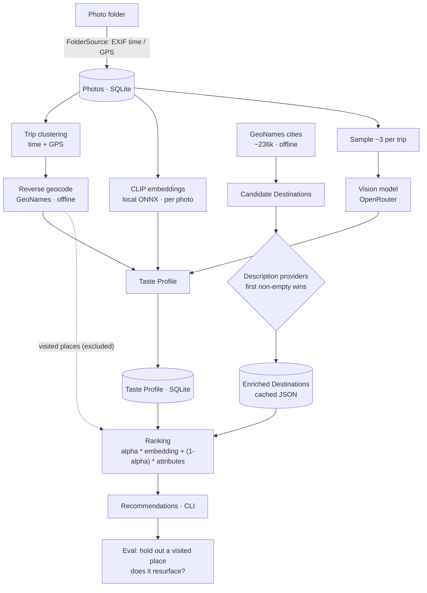
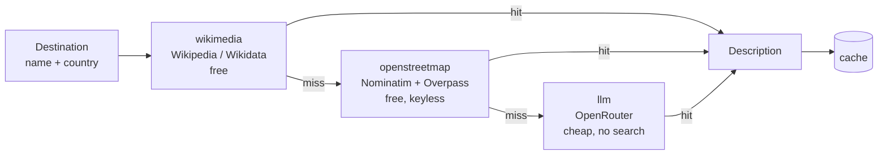

# Wanderlens

Learn a travel **Taste Profile** from a personal **Photo Archive** and recommend
new **Destinations**. Single-user today, built to become a portable open-source
app later.

## What it does

1. **Ingest** photos from a local folder (EXIF timestamp, GPS, dimensions).
2. **Profile** them: group photos into trips (time + GPS), resolve each trip to a
   country/city offline, embed every photo locally with CLIP, and tag a sample
   with a hosted vision model.
3. **Recommend** new destinations: embed candidate Destinations, rank them
   against your taste (excluding where you've already been), and explain each
   using your own photos.
4. **Evaluate** by holding out a visited place and checking whether it resurfaces.

## How it works



**Description providers** — each candidate Destination is described by the first
provider that returns something, then cached:



## Install

```bash
python3 -m venv .venv
.venv/bin/pip install -e '.[dev,embeddings]'
```

The CLIP ONNX model is downloaded automatically on first use into
`data/models/`. Offline place data goes in `data/catalog/`:

```bash
mkdir -p data/catalog
curl -sL https://download.geonames.org/export/dump/cities500.zip -o /tmp/c.zip
python3 -c "import zipfile; zipfile.ZipFile('/tmp/c.zip').extractall('data/catalog')"
curl -sL https://download.geonames.org/export/dump/countryInfo.txt -o data/catalog/countryInfo.txt
```

To pull photos from a pCloud public folder link (walks subfolders, skips
already-downloaded files):

```bash
.venv/bin/python scripts/download_pcloud.py --code <public-link-code>
```

## Use

```bash
# read photos and build the taste profile (add --tag to also run the VLM)
.venv/bin/python -m wanderlens ingest [--tag]

.venv/bin/python -m wanderlens profile show
.venv/bin/python -m wanderlens recommend --count 5
.venv/bin/python -m wanderlens eval [--holdout Malta]
```

`--tag` sends a small sample of photos (~3 per trip) to the configured vision
model. Without it, subject tags are skipped; geography and aesthetics are still
computed locally.

## Architecture

Ports and adapters. The `core/` never imports a photo manager or a model runtime:

```
wanderlens/
  core/       taste + recommendation, ports, vocabulary (no external imports)
  sources/    Photo Source adapters (local folder; Immich deferred)
  catalog/    place data (GeoNames/Wikidata), normalization, offline cache
  models/     the only place that imports onnxruntime/tokenizers or calls a VLM
  pipeline/   ingest, profile, recommend, evaluate
  cli/        argparse entry point
```

Data (`data/`) is git-ignored: photos, the SQLite database, model files, catalog.

## Destination descriptions (providers)

Candidate destinations are described by an ordered chain of providers; the first
non-empty description wins and is cached. Wikimedia is one provider, not the only
one. Configure the order via env/config:

- `wikimedia` (default) — Wikipedia extracts / Wikidata descriptions, free.
- `openstreetmap` (default) — free, keyless feature words from OSM tags
  (coastline, beach, marina, historic…), via Nominatim + Overpass. Best-effort:
  the public Overpass servers are sometimes busy and the chain moves on.
- `llm` (default fallback) — one sentence from a cheap hosted LLM
  (`meta-llama/llama-3.1-8b-instruct`, no search by default).

Default order: `wikimedia → openstreetmap → llm`.

```bash
WANDERLENS_DESCRIPTION_PROVIDERS=wikimedia,openstreetmap,llm
WANDERLENS_LLM_MODEL=meta-llama/llama-3.1-8b-instruct
```

Only place names are sent to the LLM — never photos. Results are cached in
`data/catalog/destinations*.json`, so each place is described at most once.

**Do not add `:online` by default.** Search grounding is billed per request
(≈ $0.007 via Exa) and costs far more than the tokens. Wikimedia already covers
notable places; if you need search for obscure ones, opt in and prefer a cheap
engine, e.g. `WANDERLENS_LLM_MODEL=meta-llama/llama-3.1-8b-instruct:online` with
Parallel turbo (`$0.001`/request).

## Testing

```bash
.venv/bin/python -m pytest -q
bash scripts/smoke.sh   # end-to-end over data/photos
```

## Status & limitations

- v1 is single-user; every persisted row carries a `user` id for the future
  multi-user/open-source app.
- Destination descriptions come from a provider chain (Wikimedia / OpenStreetMap
  / cheap LLM); ranking blends embeddings with canonical-attribute matching.
  Ranking is plausible but coarse — see `docs/ROADMAP.md`.
